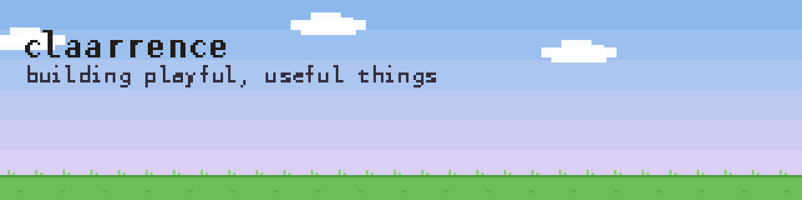

  

### hey, I'm claarrence 👋

I like building playful, useful things, like a desktop duck that roasts me for opening tetr.io in the middle of a focus session.

### 🦆 Featured projects

<table>
  <tr>
    <td width="50%" valign="top">
      <h4>🦆 Ducky <i>(open-sourcing soon)</i></h4>
      A native macOS desktop pet that keeps you focused. It wanders your screen, runs pomodoro and open focus sessions,
      and gently (then not so gently) nudges you off distracting sites, without AI and without anything leaving your Mac.
      It has Tamagotchi-style needs, and earns a daily drip of outfits as you focus.
        
      <code>Swift</code> <code>AppKit</code> <code>macOS</code>
    </td>
    <td width="50%" valign="top">
      <h4>🌏 lexdroid</h4>
      A RegTech tool built at a hackathon for the UN. It helps researchers streamline the process of
      ranking countries against the pillars of the RDTII (Regional Digital Trade Integration Index).
        
      <code>RegTech</code> <code>Hackathon</code> <code>UN</code>
    </td>
  </tr>
</table>

<!--
### 🔗 Elsewhere
LinkedIn: https://www.linkedin.com/in/YOUR-HANDLE
-->
